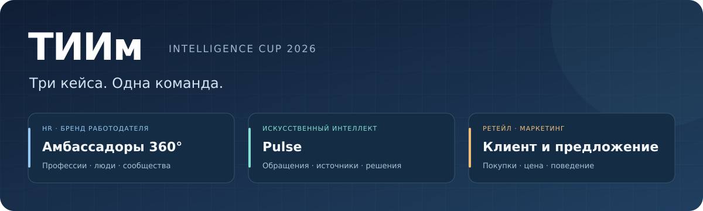

# ТИИм · Intelligence Cup 2026

Репозиторий команды «ТИИм» для кейс-чемпионата компании «Газпром нефть».
Здесь собраны три направления: развитие программы амбассадоров, анализ
обращений с помощью ИИ и задачи ретейла и маркетинга. У каждого кейса —
своя страница, материалы решения и текущий статус.

[HR и бренд работодателя](cases/hr-ambassadors/README.md) · [Искусственный интеллект](cases/ai-agent/README.md) · [Ретейл и маркетинг](cases/retail-marketing/README.md)

## Три кейса

| Направление | Решение | Что есть в репозитории |
| --- | --- | --- |
| [HR и бренд работодателя](cases/hr-ambassadors/README.md) | «Амбассадоры 360°: Живая карта профессий» — развитие сообщества сотрудников и студентов | Концепция, операционная модель, пилот, мотивация, KPI, ресурсная модель и материалы защиты |
| [Искусственный интеллект](cases/ai-agent/README.md) | ТИИм Pulse — превращение обращений в проверяемые продуктовые сигналы | Запускаемый локальный прототип, панель, API, версии тикетов, тесты и отчеты экспериментов |
| [Ретейл и маркетинг](cases/retail-marketing/README.md) | Анализ покупок, цены топлива, поведения клиентов и персональных предложений | Стартовая страница направления; подробное решение готовится отдельно |

## С чего начать

### HR · Амбассадоры 360°

Программа объединяет профессиональные истории, инициативы сотрудников и
студентов и региональную обратную связь. Решение учитывает управление четырьмя
кураторами и не требует новой IT-платформы.

[Обзор кейса](cases/hr-ambassadors/README.md) · [Концепция](cases/hr-ambassadors/flagship-concept.md) · [План пилота](cases/hr-ambassadors/pilot-playbook.md) · [Материалы защиты](cases/hr-ambassadors/jury-defense.md)

### ИИ · ТИИм Pulse

Pulse находит повторяющиеся проблемы и потребности, показывает исходные
обращения и сохраняет решение аналитика. При обновлении тикета видно, как
изменилась доказательная база сигнала. Проверенный снимок передается
в очередь владельца продукта.

[О продукте](cases/ai-agent/README.md) · [Запуск](cases/ai-agent/README.md#проверить-локально) · [Демонстрация](cases/ai-agent/README.md#сценарий-демонстрации) · [Стек](cases/ai-agent/README.md#технологический-стек) · [Исходники](cases/ai-agent/mvp/) · [Проверки CI](https://github.com/DizzyZ7/GAZPROM_Intelligence_Cup_2026/actions/workflows/pulse-ci.yml)

### Ретейл · Клиент, цена и предложение

Направление посвящено покупательскому поведению, чувствительности к цене
топлива, персональным предложениям и оценке экономического эффекта.
Развернутые материалы будут добавляться в отдельный каталог кейса.

[Страница направления](cases/retail-marketing/README.md)

## Структура репозитория

| Каталог | Содержание |
| --- | --- |
| [cases/hr-ambassadors](cases/hr-ambassadors/) | Программа амбассадоров: концепция, процессы, измерение эффекта и защита |
| [cases/ai-agent](cases/ai-agent/) | Pulse: описание продукта, архитектура и материалы ИИ-кейса |
| [cases/ai-agent/mvp](cases/ai-agent/mvp/) | Исполняемый прототип, панель, API, тесты, контрольные наборы и отчеты |
| [cases/retail-marketing](cases/retail-marketing/) | Материалы ретейла и маркетинга |
| [docs/assets](docs/assets/) | Общие визуальные материалы и баннеры |

Технологический стек, команды запуска и контракт API Pulse находятся
[на странице продукта](cases/ai-agent/README.md#технологический-стек) и
[в технической документации](cases/ai-agent/mvp/README.md).

## Как читать результаты

- Факты задания, результаты проверок и проектные гипотезы обозначаются отдельно.
- Для каждого кейса состояние описывается по фактически доступным материалам.
- Числовые цели и расчеты не выдаются за подтвержденный бизнес-эффект.
- Исходники и тесты позволяют проверить поведение прототипа; синтетические
  эксперименты не заменяют испытания на реальных обезличенных данных.
- В конкурсном прототипе Pulse не используются внешние LLM и внешние API.

Документация и пользовательские инструкции ведутся на русском языке.

## Конкурс

Ключевые даты по материалам чемпионата: подача работ — 13 ноября 2026,
объявление результатов — 23 ноября, очный финал — 26 ноября.
