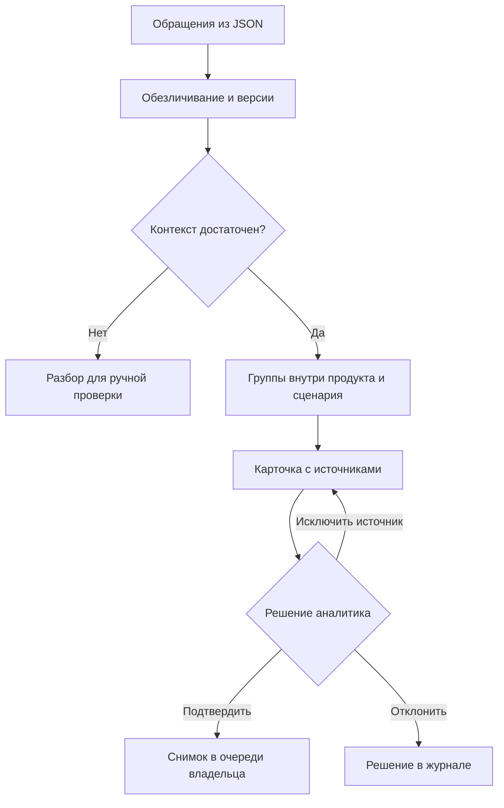

# ТИИм · Intelligence Cup 2026

Решения команды «ТИИм» для кейс-чемпионата компании «Газпром нефть».
Основной технический прототип — Pulse: система, которая связывает повторяющиеся
обращения пользователей с проверяемыми продуктовыми сигналами.

[](https://github.com/DizzyZ7/GAZPROM_Intelligence_Cup_2026/actions/workflows/pulse-ci.yml)


[Быстрый запуск](#быстрый-запуск-pulse) · [О продукте](cases/ai-agent/README.md) · [Техническая документация](cases/ai-agent/mvp/README.md) · [Проверки](https://github.com/DizzyZ7/GAZPROM_Intelligence_Cup_2026/actions)

## Что делает Pulse

Поддержка получает много разрозненных сообщений. Pulse помогает найти в них
повторяющиеся проблемы и потребности: показывает исходные обращения, отделяет
разные сценарии и передает владельцу продукта снимок, проверенный аналитиком.

| Возможность | Поведение |
| --- | --- |
| Анализ обращений | Категория, сценарий, операция и наблюдаемый результат; неоднозначность направляется на проверку |
| Поиск повторов | Учитываются продукт и контекст; сходство текста само по себе не объединяет разные проблемы |
| Доказательства | Обезличенные источники, признаки группировки и журнал решений в карточке |
| Версии тикетов | История текстов, защита от устаревшей версии, повтор без дублирования событий |
| Изменения сигнала | Видно, какие источники добавились или перестали подтверждать проблему и почему |
| Передача владельцу | Подтвержденный снимок и решение сохраняются при последующих обновлениях |

## Стек

Стек ниже относится к техническому прототипу Pulse.

| Слой | Технологии | Назначение |
| --- | --- | --- |
| Ядро | Python 3.11 / 3.12 | Контекстный анализ, версии, группировка и CLI |
| API | FastAPI, Pydantic, Uvicorn | Проверка входных данных и HTTP-интерфейс |
| Хранение | SQLite | Источники, неизменяемые версии, транзакции, карточки и аудит |
| Интерфейс | HTML, CSS, JavaScript | Панель аналитика и очередь владельца, без сборки frontend |
| Локальные модели | Ollama, BGE-M3, Qwen | Адаптер и отдельные офлайн-эксперименты; модели не включены в основной импорт |
| Проверки | unittest, HTTPX, Ruff, Bandit, pip-audit | Регрессии API, качество кода и аудит зависимостей |
| CI | GitHub Actions | Проверки на Python 3.11 и 3.12, сверка отчетов и воспроизводимости |

## Путь сигнала



## Быстрый запуск Pulse

Нужен Python 3.11 или 3.12. Команды для Bash:

```bash
git clone https://github.com/DizzyZ7/GAZPROM_Intelligence_Cup_2026.git
cd GAZPROM_Intelligence_Cup_2026/cases/ai-agent/mvp
python -m venv .venv
source .venv/bin/activate
python -m pip install -r requirements-api.txt
export PULSE_DB=pulse-demo.sqlite3
export PULSE_REVIEW_TOKEN=pulse-demo-local
python cli.py --db pulse-demo.sqlite3 import --file demo_product_flow.json
python -m uvicorn api:app --host 127.0.0.1 --port 8000
```

Откройте [панель аналитика](http://127.0.0.1:8000/dashboard), введите
демонстрационный токен `pulse-demo-local` и выберите карточку. Интерактивный
[контракт API](http://127.0.0.1:8000/docs) доступен на том же сервере.
Для Windows и полного сценария проверки — [инструкция запуска](cases/ai-agent/mvp/README.md#установка-и-запуск).

## Направления команды

| Кейс | Материалы | Состояние |
| --- | --- | --- |
| Искусственный интеллект | [ТИИм Pulse](cases/ai-agent/README.md) | Локальный MVP, панель, версии источников и проверяемые отчеты |
| HR и бренд работодателя | [Программа «Амбассадоры»](cases/hr-ambassadors/README.md) | Разработка решения и материалов защиты |
| Ретейл и маркетинг | [Материалы кейса](cases/retail-marketing/README.md) | Подготовка |

## Навигация

| Раздел | Что внутри |
| --- | --- |
| [Описание Pulse](cases/ai-agent/README.md) | Назначение, возможности и фактические ограничения |
| [Документация MVP](cases/ai-agent/mvp/README.md) | Установка, демонстрация, API, версии обращений и проверки |
| [Архитектура](cases/ai-agent/architecture-v1.md) | Исходная проектная схема и границы интеграций |
| [Исходники и тесты](cases/ai-agent/mvp/) | Рабочий код приложения, CLI и регрессии |
| [Контрольный набор](cases/ai-agent/mvp/dataset/README.md) | Генератор синтетических обращений и валидация |
| [Протокол оценки](cases/ai-agent/mvp/benchmark/README.md) | Разделение выборок и воспроизводимые отчеты |

## Границы и принципы

Рабочий импорт использует контекстные правила. Локальные модели проверяются
отдельно: экспериментальные результаты не означают подтвержденную точность на
корпоративных данных. ASR/VL, корпоративная тикет-система и промышленный RBAC
пока не подключены. Общий локальный токен предназначен для демонстрации.

В конкурсном решении не используем внешние LLM и внешние API. Человек проверяет
передачу сигнала; исходные факты, гипотезы и синтетические данные разделены.
Инструкции и документация ведутся на русском языке.

Ключевые даты по материалам конкурса: подача работ — 13 ноября 2026,
объявление результатов — 23 ноября, очный финал — 26 ноября.
