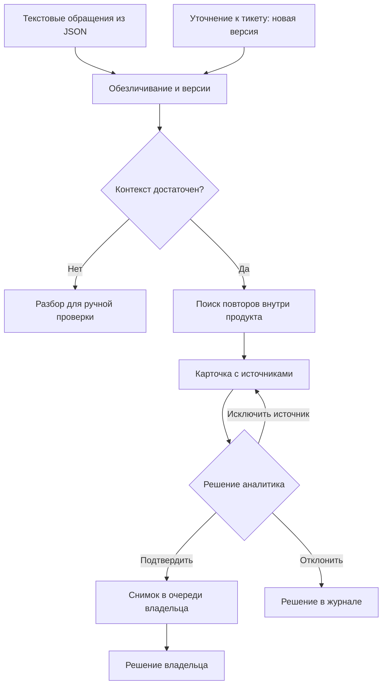

# ТИИм Pulse

Цифровой пульс продуктов: повторяющиеся проблемы пользователей,
проверяемые источники и решения продуктовой команды в одном процессе.

Решение команды «ТИИм» для кейса «ИИ-агент для ретрансляции обращений в поддержку».
Текущая реализация — локальный прототип с панелью аналитика, API и историей версий.

[](https://github.com/DizzyZ7/GAZPROM_Intelligence_Cup_2026/actions/workflows/pulse-ci.yml)


[Запуск](#проверить-локально) · [Демо](#сценарий-демонстрации) · [Архитектура](#как-работает-pulse) · [Стек](#технологический-стек) · [Проверки и эксперименты](#что-можно-проверить) · [API и инструкция](mvp/README.md) · [Все кейсы команды](../../README.md)

## Зачем нужен Pulse

Поддержка решает отдельные обращения, а владельцу продукта нужно видеть
повторяющуюся потребность: что происходит, где повторяется, какими источниками
подтверждено и что изменилось после новых данных. В большом потоке эта связь
теряется между тикетами и ручными сводками.

Pulse связывает обращения с продуктовым сигналом и сохраняет основания решения.
Аналитик проверяет источники перед передачей; владелец получает зафиксированный
снимок и может отметить, что тема известна, взята в работу или требует уточнения.

| Участник | Что получает |
| --- | --- |
| Аналитик поддержки | Группы обращений, контекст сопоставления, причины отказа от группировки и историю изменений |
| Владелец продукта | Подтвержденный снимок сигнала с источниками и возможностью записать свое решение |
| Команда внедрения | Локальный API, CLI, проверяемый контракт версий и воспроизводимые проверки |

## Как работает Pulse



Рабочий разбор учитывает продукт, категорию, сценарий, операцию и наблюдаемый
результат. Дополнительное сходство по эмбеддингам доступно через явно выбранный
провайдер. При распознанной неоднозначности система отказывается от автоматической
группировки и показывает причину аналитику.

### Что важно различать

| Похожие обращения | Проверяемое поведение |
| --- | --- |
| Заменить контактный телефон / сохранить основной и добавить запасной | Разные потребности не объединяются только из-за слова «телефон» |
| Скачать готовый отчет / скачать подписанный договор | Учитываются разные объекты и сценарии |
| `Not Found` / явно указанный `HTTP 404` | Числовой код не приписывается, если его нет в источнике |
| Выдать доступ / сообщить об ошибке | Индивидуальный запрос поддержки отделяется от продуктового сбоя |
| Напомнить перед приемом / сообщить о свободном слоте | Разные условия уведомления образуют разные контексты |
| Сбой устранен / сбой не исправили / ошибка возникла снова | Устранение проверяется с учетом распознанных отрицаний и повторного сбоя |

Эти сценарии закреплены в [регрессиях рабочего разбора](mvp/tests/test_product_context.py)
и [проверках актуальности](mvp/tests/test_active_issue.py). Правила покрывают
ограниченные конструкции языка; таблица не означает универсального понимания текста.

## Обновление тикета — изменение доказательств

Пример: сигнал подтверждают три обращения. Один клиент дополняет свой тикет
сообщением об устранении сбоя. В этом примере его ID — `ticket-17`,
текущая версия — 1. Импорт принимает новую версию:

```json
{
  "tickets": [{
    "id": "ticket-17",
    "product": "Кабинет",
    "version": 2,
    "text": "При бронировании была ошибка 404. Сбой исправили, теперь бронирование работает."
  }]
}
```

В карточке видно, какой источник обновился, его переход с версии 1 на 2 и причину:
«Клиент сообщил об устранении сбоя. Активных источников стало 2 вместо 3».
Ранее подтвержденный снимок сохраняется в истории, а изменившаяся карточка
помечается как требующая повторной проверки.

| Событие | Результат |
| --- | --- |
| Та же версия и тот же обезличенный текст | Повтор не добавляет версию или событие |
| Более старая версия | Отказ с 409; текущие данные остаются прежними |
| Тот же номер с другим содержимым | Конфликт и откат всего пакета |
| Новый симптом | Меняются связанные источники; отдельный сигнал требует второго подходящего обращения |
| Обновление после подтверждения | Решение и переданный снимок сохраняются; изменение текущих доказательств видно отдельно |

Продукт, канал и известная исходная дата обращения неизменяемы. Подробный
[контракт версий](mvp/README.md#версии-обращений-api-07) описывает миграцию,
восстановление прежней карточки и ограничения семантического пересчета.

## Проверить локально

Нужен Python 3.11 или 3.12. Команды для Bash из корня клонированного репозитория:

```bash
cd cases/ai-agent/mvp
python -m venv .venv
source .venv/bin/activate
python -m pip install -r requirements-api.txt
export PULSE_DB=pulse-demo.sqlite3
export PULSE_REVIEW_TOKEN=pulse-demo-local
python cli.py --db pulse-demo.sqlite3 import --file demo_product_flow.json
python -m uvicorn api:app --host 127.0.0.1 --port 8000
```

Откройте [панель аналитика](http://127.0.0.1:8000/dashboard), введите демонстрационный
токен `pulse-demo-local` и выберите карточку. Документация API находится
[на том же сервере](http://127.0.0.1:8000/docs).

Для чистой демонстрации используйте новую базу. В
[сценарии проверки](mvp/README.md#демонстрация-передачи-сигнала) показаны загрузка,
исключение ошибочного совпадения, повторный импорт, подтверждение и решение владельца.
Настройка Windows и подробности API — в [технической инструкции](mvp/README.md).

### Сценарий демонстрации

1. **Проверьте источники.** В карточке «Кабинет · booking_queue» сравните три обращения. У `booking-history` ошибка возникает при просмотре старого талона, а в двух других случаях сбой мешает завершить запись.
2. **Исправьте карточку.** Нажмите «Это другая проблема» у `booking-history` и укажите причину. Повторный импорт того же файла сохранит исключение.
3. **Передайте сигнал.** Подтвердите карточку и откройте снимок с двумя источниками в очереди владельца. Выберите «Тема уже известна» и запишите основание.

> [!TIP]
> Для отдельной демонстрации обновлений используйте [пример с новой версией тикета](#обновление-тикета--изменение-доказательств). В истории карточки виден переход между версиями и причина изменения состава источников.

## Технологический стек

| Слой | Технологии | Что они делают в Pulse |
| --- | --- | --- |
| Ядро и CLI | **Python 3.11 / 3.12**, argparse | API и командная строка используют один сервис импорта. Он обезличивает обращения, определяет контекст и обновляет затронутые сигналы. |
| HTTP | **FastAPI**, Pydantic, Uvicorn | FastAPI публикует маршруты и OpenAPI. Pydantic проверяет форму запросов, а Uvicorn запускает локальный сервер. |
| Данные | **SQLite**, JSON, CSV | SQLite хранит текущие обращения, историю версий, решения и снимки владельца. Импорт проходит в одной транзакции. JSON используется для входных пакетов, CSV и JSON для разметки и отчётов. |
| Панель | **HTML5**, CSS, JavaScript | FastAPI отдаёт страницу и статические файлы. Панель обращается к API через Fetch, показывает фрагменты, историю, результаты проверки и очередь владельца. Для запуска достаточно сервера Python. |
| Локальный ML | **Ollama**, BGE-M3, Qwen, TF-IDF | BGE-M3 сравнивает эмбеддинги, Qwen проверялся для извлечения операции и симптома. TF-IDF служит классическим методом сравнения в экспериментах. Основной режим импорта использует контекстные правила. |
| Тестирование | **unittest**, HTTPX | Проверяются группировка, повторный импорт, конфликт версий и передача снимка. HTTPX используется в тестовом клиенте для проверок API. |
| Проверки кода и CI | **Ruff**, Bandit, pip-audit, GitHub Actions | CI запускает тесты на Python 3.11 и 3.12, статические проверки и аудит зависимостей, проверяет контрольные наборы и сохранённые отчёты. |

### Основные части приложения

| Модуль | Ответственность |
| --- | --- |
| [service.py](mvp/service.py) | Общий атомарный импорт для API и CLI |
| [product_analysis.py](mvp/product_analysis.py) | Контекстные границы группировки |
| [ticket_versions.py](mvp/ticket_versions.py) | Неизменяемая история и монотонная версия источника |
| [signal_updates.py](mvp/signal_updates.py) | Пересчет затронутых источников и объяснение изменений |
| [store.py](mvp/store.py) | Хранение, транзакции, решения и снимки |
| [api.py](mvp/api.py) / [dashboard.js](mvp/dashboard.js) | Контракт API и действия в панели |
| [ollama_embeddings.py](mvp/ollama_embeddings.py) / [structured_context.py](mvp/structured_context.py) | Адаптер эмбеддингов и эксперимент по извлечению контекста |
| [benchmark/](mvp/benchmark/) / [dataset/](mvp/dataset/) | Воспроизводимая оценка, генерация и проверка контрольных данных |

## Что можно проверить

Зеленый CI подтверждает прохождение технических проверок. Он не является
оценкой точности классификации на корпоративном потоке.

| Свойство | Доказательство |
| --- | --- |
| Разные потребности и симптомы не сливаются в проверенных сценариях | [Тесты контекстного разбора](mvp/tests/test_product_context.py) |
| Версии, повторы, миграция, откат и конкурентные обновления | [Хранилище и сигналы](mvp/tests/test_ticket_versions.py), [контракт API](mvp/tests/test_ticket_versions_api.py) |
| Проверенная версия карточки и сохранение переданного снимка | [Сценарии передачи](mvp/tests/test_review_handoff.py) |
| Ограничения HTTP и обработка контактов | [Лимиты запросов](mvp/tests/test_http_limits.py), [маскирование](mvp/tests/test_redaction_limits.py) |
| Структура и воспроизводимость синтетических данных | [Контрольный набор](mvp/dataset/README.md) |
| Запуски проверок на обеих версиях Python | [GitHub Actions](https://github.com/DizzyZ7/GAZPROM_Intelligence_Cup_2026/actions/workflows/pulse-ci.yml) |

### Локальные модели: измеренные результаты

Основной импорт использует контекстные правила. Реальные BGE-M3 и Qwen
проверены локально, но эксперименты пока не дали основания включить их в
автоматическую обработку рабочего потока. Результаты, пропуски и ограничения
сохранены вместе с параметрами запусков.

| Эксперимент | Материалы |
| --- | --- |
| Контекстные правила, TF-IDF и BGE-M3 | [Контекстный контроль](mvp/benchmarks/pulse-context-v2.3/README.md) |
| Операция, симптом и подтверждающие цитаты | [Структурированное извлечение](mvp/benchmarks/pulse-structured-context-v1.1/README.md) |
| Дословные фрагменты и нормализация | [Выделение фрагментов](mvp/benchmarks/pulse-span-context-v1/README.md) |
| Семантические кандидаты с фильтрами контекста | [Поиск кандидатов](mvp/benchmarks/pulse-quote-candidates-v1/README.md) |
| Частичная независимая обратная связь | [Пакет человеческой проверки](mvp/reviews/pulse-synthetic-v1-20276830/README.md) |

## Границы текущей реализации

Импорт принимает текстовые JSON-записи. ASR/VL, корпоративная тикет-система,
промышленная авторизация и RBAC пока не подключены. Используется общий токен
локального демонстрационного контура; маскирование распознает известные шаблоны
email и телефонов РФ. Внешние LLM и внешние API в конкурсном прототипе не вызываются.

Ручное исключение источника и решения сохраняются. Интерфейс согласованного
слияния/разделения существующих сигналов, повторное подтверждение уже переданного
снимка и отправка уточняющих вопросов остаются отдельными задачами. Синтетические
наборы требуют доменной проверки и не заменяют испытания на реальных данных.

## Документация и материалы

[Запуск, демонстрация и API](mvp/README.md) · [Проектная архитектура](architecture-v1.md) · [Контракт промпта](prompt-v1.md) · [Приемка](acceptance-v1.md) · [Концепция продукта](product-strategy.md) · [Все кейсы «ТИИм»](../../README.md)
