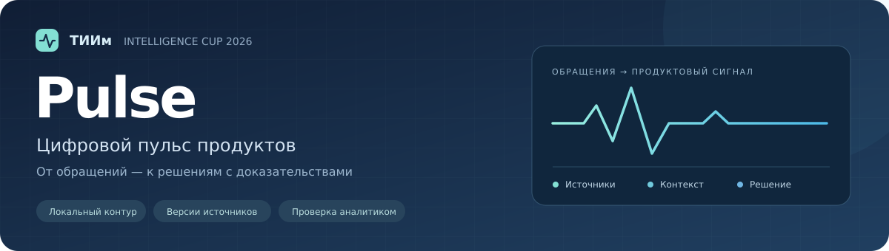

# ТИИм Pulse

Цифровой пульс продуктов: от обращений в поддержку — к повторяющимся проблемам,
проверяемым источникам и решениям продуктовой команды.
Конкурсный кейс — «ИИ-агент для ретрансляции обращений в поддержку».

[Запуск и API](mvp/README.md) · [Исходники](mvp/) · [Контроль качества](mvp/benchmark/README.md) · [Все кейсы команды](../../README.md)

## Задача

В потоке сообщений, звонков и вложений повторяющиеся пожелания и некритичные
проблемы часто остаются отдельными тикетами. Pulse связывает обращения одной
темы, показывает основания для группировки и передает проверенный сигнал
владельцу продукта. Конкретный импорт прототипа принимает текстовые JSON-записи;
распознавание аудио и изображений остается задачей интеграции.

## Возможности прототипа

| Этап | Реализовано |
| --- | --- |
| Прием | Накопительный импорт через API и CLI, проверка схемы и обезличивание известных шаблонов контактов |
| Разбор | Категория, сценарий, операция, симптом и причина отказа от автоматической группировки |
| Сопоставление | Разделение продуктов и потребностей; дополнительные эмбеддинги через явный провайдер |
| Источники | Неизменяемая история версий и защита от повторов, устаревших обновлений и конфликтов |
| Карточка | Фрагменты источников, признаки группировки, версия и объяснение изменения состава |
| Проверка | Решение аналитика, исключение ошибочного совпадения и журнал |
| Передача | Неизменяемый снимок в очереди владельца и фиксация его решения |

Например, если клиент сообщил об устранении сбоя, текущая карточка покажет:
«Активных источников стало 2 вместо 3». История предыдущей версии и ранее
подтвержденный снимок сохраняются. Подробный [контракт версий](mvp/README.md#версии-обращений-api-07).

## Технологии

| Контур | Стек |
| --- | --- |
| Приложение | Python 3.11/3.12, FastAPI, Pydantic, Uvicorn |
| Данные | SQLite, JSON; CSV/JSON для разметки и отчетов |
| Панель | HTML, CSS и JavaScript, без сборки frontend |
| Локальный ML | Адаптер Ollama; BGE-M3 и Qwen в отдельных офлайн-проверках |
| Проверки | unittest, HTTPX, Ruff, Bandit, pip-audit, GitHub Actions |

## Статус моделей и качества

Основной импорт работает на контекстных правилах. Реальные BGE-M3 и Qwen
проверены локально, но эксперименты пока не дали основания включить их в
автоматическую обработку рабочего потока. Отказы и ограничения опубликованы
вместе с результатами. Синтетические тесты не заменяют проверку на реальных
обезличенных обращениях.

| Материалы | Содержание |
| --- | --- |
| [Контекстный контроль](mvp/benchmarks/pulse-context-v2.3/README.md) | Правила, TF-IDF и локальные эмбеддинги |
| [Структурированное извлечение](mvp/benchmarks/pulse-structured-context-v1.1/README.md) | Операция, симптом и подтверждающие цитаты |
| [Выделение фрагментов](mvp/benchmarks/pulse-span-context-v1/README.md) | Дословные цитаты и нормализация |
| [Поиск кандидатов](mvp/benchmarks/pulse-quote-candidates-v1/README.md) | Семантический поиск с фильтрами контекста |
| [Пакет человеческой проверки](mvp/reviews/pulse-synthetic-v1-20276830/README.md) | Частичная обратная связь и разногласия |

## Документация

- [Рабочая инструкция, демонстрация и API](mvp/README.md)
- [Проектная архитектура](architecture-v1.md)
- [Контракт промпта](prompt-v1.md)
- [Проверка качества и приемка](acceptance-v1.md)
- [Концепция конкурсного продукта](product-strategy.md)
- [Датасет и протокол разметки](mvp/dataset/README.md)

Корпоративные интеграции, промышленная авторизация и ASR/VL пока не реализованы.
Внешние LLM и внешние API в конкурсном решении не используются; будущий адаптер
внутренних моделей требует согласованного контракта.
