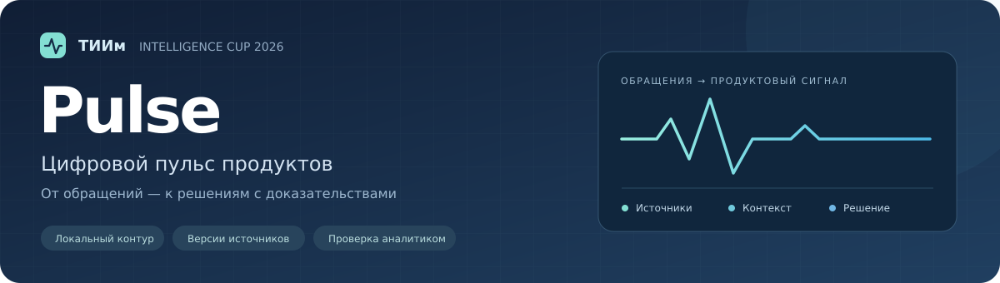

[](https://github.com/DizzyZ7/GAZPROM_Intelligence_Cup_2026/actions/workflows/pulse-ci.yml)


# ТИИм Pulse · запуск и техническая документация

Прототип классифицирует обращения, группирует повторы и показывает аналитику обезличенные источники. Подтвержденная версия карточки поступает в очередь владельца продукта, где можно зафиксировать решение и его основание.

[Установка](#установка-и-запуск) · [Демонстрация](#демонстрация-передачи-сигнала) · [API](#api) · [Версии тикетов](#версии-обращений-api-07) · [Проверки](#проверки)

## Технический стек

| Слой | Реализация |
| --- | --- |
| Runtime | Python 3.11 / 3.12 |
| HTTP | FastAPI + Pydantic, ASGI-сервер Uvicorn |
| Хранилище | SQLite: транзакции, версии источников, карточки и история решений |
| Панель | HTML / CSS / JavaScript; отдельная сборка и Node.js для запуска не нужны |
| Исследования | Локальная Ollama, эмбеддинги BGE-M3, отдельные проверки Qwen |
| Качество | unittest + HTTPX, Ruff, Bandit, pip-audit; матрица GitHub Actions |

## Реализованные возможности

- Накопительный импорт JSON через CLI и FastAPI: отдельные пакеты участвуют в общем анализе, повторный импорт идемпотентен.
- Контекстный разбор рабочего импорта: категория, сценарий, операция и наблюдаемый результат; при неоднозначности — ручная проверка. Исторический baseline из пяти правил сохранен в `pulse.py`.
- Рабочий импорт проверяет явные указания на устранение сбоя до группировки и передачи текста embedding-provider. Старые источники с таким указанием отмечаются в карточке и требуют проверки перед подтверждением.
- Группировка по продукту, категории и сценарию; отдельный семантический pipeline с контрактом `EmbeddingProvider` и complete-link сопоставлением.
- Локальный адаптер Ollama: только loopback HTTP, без перенаправлений и proxy из окружения. Реальный инференс BGE-M3 выполнен в исследовательском benchmark; его ограничения описаны в [отчете](benchmarks/pulse-context-v2.3/README.md).
- SQLite сохраняет обращение и результат анализа в одной транзакции. Подтверждение, запись аудита и передача карточки также выполняются атомарно.
- Панель позволяет загрузить JSON, найти сигнал, сравнить источники, исключить ошибочное совпадение и открыть историю. Владелец видит снимок при передаче и сохраняет свое решение в очереди.
- Синтетический контрольный набор на 500 обращений, генератор других размеров и структурная проверка разметки.
- Независимый benchmark с фиксацией параметров до holdout, раздельными метриками и отчетами JSON/CSV. Сохранены исторические результаты Rules/TF-IDF и отдельный эксперимент с контекстными правилами, TF-IDF и локальными эмбеддингами.
- Сценарный финансовый калькулятор с учетом разработки и эксплуатации.

## Установка и запуск

Используйте Python 3.11 или 3.12. Все команды ниже выполняются из `cases/ai-agent/mvp`.

```bash
python -m venv .venv
source .venv/bin/activate
python -m pip install -r requirements-api.txt
python cli.py --db demo.sqlite3 import
python cli.py --db demo.sqlite3 list
signal_id='Вебнефть:bug:booking_queue'
card=$(python cli.py --db demo.sqlite3 show "$signal_id")
printf '%s\n' "$card"
```

После проверки показанной карточки подтвердите ее версию.

```bash
revision=$(printf '%s\n' "$card" | python -c 'import json, sys; print(json.load(sys.stdin)["revision"])')
python cli.py --db demo.sqlite3 review "$signal_id" --revision "$revision" --action approved --actor analyst --reason 'Проверено по источникам'
python cli.py --db demo.sqlite3 audit "$signal_id"
```

В Windows PowerShell окружение активируется командой `.venv\Scripts\Activate.ps1`.

Для панели задайте `PULSE_REVIEW_TOKEN` через переменную окружения, затем:

```bash
python cli.py --db pulse-demo.sqlite3 import
uvicorn api:app --host 127.0.0.1 --port 8000
```

Откройте [панель](http://127.0.0.1:8000/dashboard) или [документацию API](http://127.0.0.1:8000/docs). Токен хранится в памяти страницы. Путь к базе задается через `PULSE_DB`, по умолчанию используется `pulse-demo.sqlite3` рядом с `api.py`.

## Демонстрация передачи сигнала

Запустите API с новой SQLite-базой и локальным токеном.

```bash
PULSE_DB=pulse-flow-demo.sqlite3 PULSE_REVIEW_TOKEN=pulse-demo-local python -m uvicorn api:app --host 127.0.0.1 --port 8000
```

В PowerShell перед запуском задайте `$env:PULSE_DB = 'pulse-flow-demo.sqlite3'` и `$env:PULSE_REVIEW_TOKEN = 'pulse-demo-local'`.

1. Подключитесь к панели и загрузите `demo_product_flow.json`. В карточке «Кабинет · booking_queue» будет три источника. Обращение из «Портала» останется отдельно.
2. У `booking-history` нажмите «Это другая проблема». Укажите, что ошибка относится к просмотру старого талона, а пользователь успешно забронировал очередь. В карточке останутся два обращения об ошибке при подтверждении бронирования.
3. Загрузите тот же файл еще раз. Панель покажет ноль новых обращений, исключение останется в истории.
4. Подтвердите карточку с основанием и откройте снимок в очереди владельца. В нем будут два источника и дата первого обращения `2026-11-01T06:00:00+00:00`.
5. Выберите «Тема уже известна» и сохраните основание. Очередь и история сигнала покажут решение владельца.

## API

Просмотр и изменение данных требуют заголовок `X-Review-Token`. При отсутствии настройки сервер возвращает 503. Неверный токен получает 401. `/health` и статические файлы доступны без токена.

| Метод и путь | Назначение |
| --- | --- |
| `POST /imports` | Импорт массива `tickets` из 1–500 обращений. Поля `channel`, `occurred_at` и `version` необязательны. Для изменения текста существующего обращения нужна явная более высокая версия. |
| `GET /tickets/{id}/versions` | Обезличенная история версий обращения; нужен токен аналитика |
| `GET /signals?status=...` | Список сигналов |
| `GET /signals/{id}/card` | Текущая карточка с `revision`, проверенной версией `reviewed_revision` при наличии снимка и массивом `sources`. Для ID без слешей также доступен `GET /signals/{id}`. |
| `GET /signals/{id}/timeline` | История обновлений тикетов, изменений состава, исключений и решений |
| `POST /signals/{id}/exclude` | Принимает точный `ticket_id` из карточки, `reason` и `expected_revision`. Возвращает обновленную карточку. |
| `POST /signals/{id}/review` | Принимает `action` (`approved` или `rejected`), `reason` и `expected_revision`. Для подтверждения нужны минимум два источника и связанные фрагменты для каждого из них. |
| `GET /signals/{id}/audit` | Журнал решений аналитика |
| `GET /product-queue` | Снимки карточек, исходные даты, момент передачи и решения владельца |
| `POST /product-queue/{id}/decision` | Принимает `decision` (`in_progress`, `known` или `needs_clarification`) и `reason`. Повторное решение возвращает 409. |
| `GET /health` | Состояние локального приложения |

При переходе на API 0.6 сначала покажите карточку из `GET /signals/{id}/card`, затем передайте ее `revision` в поле `expected_revision` при подтверждении, отклонении или исключении. Запрос без версии получает 422. После 409 перечитайте карточку и повторите проверку перед новым решением. В CLI версия из `show` передается через `--revision`.

Поле `occurred_at` принимает дату и время с секундами и часовым поясом в формате ISO 8601, например `2026-11-01T09:00:00+03:00`. Дата нормализуется в UTC. При повторном импорте можно заполнить отсутствующую дату. Конфликт сохраненной даты или содержимого возвращает 409 и откатывает пакет. Ошибка 422 возвращает только сообщение о несоответствии схеме.

HTTP-тело ограничено 32 МиБ (33 554 432 байта) до разбора JSON и вызова обработчика. Превышение возвращает 413 без записи в SQLite. Ограничение проверяет фактически полученные байты, включая запросы без `Content-Length` и с заниженным значением; заявленное превышение отклоняется до чтения тела. Неправильный или повторный `Content-Length` получает 400. При разрыве соединения до завершения тела обработчик не запускается. Лимит применяется ко всем HTTP-маршрутам. Размер считается по передаваемому JSON, включая экранирование; если пакет превышает лимит, разделите его на части с уникальными ID. Ограничения 500 обращений и 10 000 символов текста продолжают действовать.

Маскирование email проверяет каждый токен перед `@` один раз. Длинное слово без пробелов не вызывает повторного перебора всех его суффиксов. Это исправление стоимости обработки сохраняет прежние шаблоны обезличивания; полное распознавание персональных данных пока отсутствует. Лимит одного запроса не заменяет сетевые тайм-ауты и ограничения одновременных соединений.

Новые обращения могут дополнить карточку аналитика. При обновлении тикета текущий состав может уменьшиться или измениться; причина сохраняется в журнале. Очередь показывает состав источников, фрагменты и даты на момент подтверждения. Дата первого обращения в очереди доступна, если у всех переданных источников была исходная дата.

Кодируйте ID сигнала при подстановке в URL, включая слеши из названия продукта. При повторном анализе Pulse пропускает группу, если все ее источники ранее исключили из одной карточки и у группы нет пересечения с текущими источниками других карточек того же продукта, категории и сценария.

При открытии старой базы таблицы создаются автоматически. Решения и сохраненные примеры доступны сразу. Чтобы подтвердить ранее открытую карточку, повторите импорт исходного пакета тем же методом и проверьте связанные фрагменты. Pulse устанавливает связь с текстом по результату анализа. Записи ранней очереди показываются как исторические с прежними решениями и без снимка.

## Синтетические обращения

В `datasets/pulse-synthetic-v1/` сохранены 500 обращений: development — 300, validation — 100, holdout — 100. Связанные семейства сценариев, включая разные продукты, повторы и изменения, не пересекают выборки. Признаки совместимы с форматом импорта; эталонная разметка хранится отдельно и не передается модели.

```bash
python -m dataset validate --directory datasets/pulse-synthetic-v1
python -m dataset generate --size 500 --seed 20261105 --output /tmp/pulse-500
python -m dataset generate --size 1000 --seed 20261105 --output /tmp/pulse-1000
python -m dataset generate --size 5000 --seed 20261105 --output /tmp/pulse-5000
python -m dataset generate --size 10000 --seed 20261105 --output /tmp/pulse-10000
```

Выходной каталог должен быть новым. Манифест фиксирует seed, версию, размер, отпечаток каталога сценариев и SHA-256 файлов. Подробный формат, ограничения и экспертная проверка: [инструкция датасета](dataset/README.md).

API и CLI принимают обращения с явным `version`, включая обновления. Файлы `*.events.jsonl` контрольного набора не являются готовым JSON-массивом импорта: отдельный проигрыватель этого формата пока не реализован. Контракт рабочего обновления описан в разделе версий ниже.

## Семантический режим

В рабочих API, CLI импорта и `pipeline.py` действует общий фильтр `issue_status.py`: обращения категории `bug` с распознанным утверждением об устранении сбоя не попадают в новые группы. Обезличенные источники сохраняются в SQLite. Ответ импорта содержит `resolved_tickets` — число таких обращений во всем накопленном наборе, а панель показывает этот счетчик. Отрицания, вопросы, обещания, условия и распознанное указание на повторный сбой не считаются подтверждением устранения.

У ранее сохраненного источника может появиться `analysis_warning: resolved_issue`. Проверка использует полный сохраненный текст, а не только фрагмент карточки. Подтверждение такой карточки блокируется сервером до исключения неактуального источника аналитиком; отклонение доступно. Сохраненные решения и переданные владельцу снимки автоматически не пересматриваются. Фильтр покрывает ограниченные русскоязычные конструкции и не заменяет проверку фактического состояния проблемы. Исторический baseline `pulse.py` и сохраненные benchmark-результаты остаются без изменений.

Если старый семантический сигнал содержит устраненный сбой, расширение новыми источниками отклоняется с требованием проверки аналитиком; весь новый пакет откатывается. Для ожидающей проверки карточки исключите неактуальный источник и повторите импорт. Исправление уже подтвержденной карточки требует отдельной согласованной процедуры, которая пока не реализована в интерфейсе.

Для исследований доступен отдельный контекстный экстрактор `ticket_context.py` и `context_pipeline.py`. Он различает категорию, сценарий, операцию и наблюдаемый симптом; при неоднозначности отказывается от группировки. Метки источника не считаются описанием проблемы, а недоверенные инструкции проверяются до удаления служебных строк. Контекстная группировка отражает общую наблюдаемую проблему, но не доказывает единую техническую причину.

В benchmark этот экстрактор включается явно через `--classifier context`. Тогда Rules, TF-IDF и Embeddings получают одинаковые предсказанные ограничения по продукту, категории, сценарию, операции и симптому. Неразрешенные и отмеченные как недоверенные обращения не передаются embedding-provider. Без флага benchmark использует прежний классификатор. Рабочие API и CLI используют отдельный `product-context-v1`, построенный на контекстных правилах с фильтром актуальности. Локальные генеративные модели и исследовательский поиск кандидатов не включены автоматически.

```python
from ollama_embeddings import OllamaEmbeddingProvider
from service import import_tickets

provider = OllamaEmbeddingProvider(model="nomic-embed-text")
result = import_tickets("semantic.sqlite3", "sample_tickets.json",
                        mode="semantic", provider=provider, threshold=0.86)
```

Нужны запущенный локальный Ollama и заранее установленная модель. `nomic-embed-text` здесь приведена как пример подключения; ее качество в текущей проверке не измерялось. Для BGE-M3 выполнен отдельный контекстный benchmark, его параметры не переносятся автоматически в этот pipeline. Порог 0,86 остается некалиброванным параметром. Семантический pipeline использует текущие правила для категории и сценария; сходство не доказывает общую техническую причину. Пересечение нового кластера с двумя существующими сигналами блокируется до согласования аналитиком. Интерфейс явного merge/split пока отсутствует.

`ExactTokenProvider` служит только для детерминированных технических демонстраций. Он не представляет семантическую модель. CLI не запускает семантический режим без явно заданного провайдера. Адаптер внутренних моделей должен разрабатываться после получения их контракта, без предположения о совместимости API.

Новый протокол позволяет сохранять отчеты development и validation по уже зафиксированным параметрам: `benchmark evaluate --split development` или `--split validation`. Для каждой выборки создается своя одноразовая квитанция. `--split holdout` остается значением по умолчанию. Финальная команда не принимает порог или замену классификатора; эталоны читаются после предсказаний всех методов. Публикация результатов holdout запрещает дальнейшую настройку на нем.

Для независимой проверки разметки подготовлен [слепой пакет на 40 обращений](reviews/pulse-synthetic-v1-20261109/README.md) и CLI `python -m dataset.review`. Пакет не содержит holdout или предложенных ответов. Человеческая доменная проверка пока ожидается; автоматический отчет о согласии ее не заменяет.

В отдельном офлайн-эксперименте Qwen3.5:4b извлекает операцию и наблюдаемый симптом из обезличенного текста. Группировка требует подтверждения обеих цитат и совпадения продукта, категории, операции и симптома. Запуск и оценка доступны через `python -m structured_eval`. [Отчет и команды воспроизведения](benchmarks/pulse-structured-context-v1.1/README.md).

Следующий офлайн-эксперимент `span_eval` сравнивает буквальное сопоставление и серверную нормализацию одних и тех же проверенных цитат. [Отчет и команды запуска](benchmarks/pulse-span-context-v1/README.md).

Офлайн-команда `quote_candidates_eval` проверяет поиск кандидатов по подтвержденным цитатам с фильтрами контекста. [Отчет и команды запуска](benchmarks/pulse-quote-candidates-v1/README.md).

Для расширения сигнала, сформированного по эмбеддингам, повторный анализ должен включить все его текущие источники в один кластер при прежнем методе и пороге. Проверка применяется при добавлении источников. При конфликте состава или параметров импорт пакета откатывается.

## Проверки

```bash
python -m unittest discover -s tests -p 'test_*.py' -v
python -m compileall -q .
python -m benchmark verify --directory benchmarks/pulse-synthetic-v1/holdout
python -m pip install -r requirements-dev.txt
ruff check --isolated --select E9,F63,F7,F82 .
ruff check --isolated --select E9,F,I dataset tests/test_dataset.py
ruff format --isolated --check dataset tests/test_dataset.py
ruff check --isolated --select E9,F,I http_limits.py tests/test_http_limits.py tests/test_redaction_limits.py
ruff format --isolated --check http_limits.py tests/test_http_limits.py tests/test_redaction_limits.py
bandit -q -r . -x ./tests -ll
pip-audit -r requirements-api.txt
```

Без зависимостей API соответствующие тесты пропускаются. CI устанавливает зависимости и проверяет обе поддерживаемые версии Python. Тесты покрывают проверку контрольных сумм, генерацию 1 000/5 000/10 000 записей, конфликт версий карточки, одновременные решения и откат транзакции. Проверяются размер в байтах на границе лимита, запросы из нескольких чанков, ложный `Content-Length`, разрыв соединения, отсутствие записи при 413 и импорт 500 русскоязычных текстов по 10 000 символов с JSON-экранированием. Отдельный тест завершает обработку длинного токена с `@` в пределах трех секунд в дочернем процессе. Сценарий панели можно повторить по инструкции выше. Нагрузочных испытаний и испытаний на корпоративных данных пока не было.

## Границы прототипа

Аналитик и владелец используют общий локальный токен. API записывает действия от имени `demo-reviewer`, а в CLI оператор задает `--actor`. Личная аутентификация и RBAC по продукту потребуются в корпоративном контуре. Маскирование фрагментов и оснований охватывает известные шаблоны телефона РФ и email. Используйте локальную демонстрацию на синтетических данных.

Интеграции ASR/VL и Qwen в рабочий импорт, корпоративная тикет-система, доставка в продуктовый трекер, полноценный Evidence Graph и мониторинг пока отсутствуют. Локальные эксперименты с Qwen описаны в отдельных отчетах.

Первый независимый benchmark сохранен как исторический: [протокол](benchmark/README.md), [результаты P2](benchmarks/pulse-synthetic-v1/README.md). На его holdout все 100 обращений получили `unknown`, pairwise F1 Rules/TF-IDF равен 0.

В [контроле context-v2.3](benchmarks/pulse-context-v2.3/README.md) выполнен реальный BGE-M3 инференс на development/validation. На новых 120 обращениях все методы с контекстным экстрактором отказались от группировки до стадии сходства; пропущены все 120 эталонных пар. Embedding-provider на этом holdout не вызывался, поэтому результат не оценивает семантический потенциал модели. Критерий продвижения P3 не выполнен; рабочие API и импорт сохраняют прежний алгоритм. Следующий приоритет — проверка локального структурированного извлечения контекста, человеческая проверка разметки и другой независимый контроль после изменения алгоритма.

`python finance.py` рассчитывает три условных сценария. Стоимость высвобожденного времени не является подтвержденной денежной экономией; окупаемость требует фактических затрат и замеров процесса.

### Разбор рабочего импорта

API `/imports` и CLI используют `product-context-v1`: намерение, сценарий,
операция и наблюдаемый результат. В API поле `classified` объясняет разбор
переданного пакета и отмечает обращения, требующие проверки. Панель показывает
этот разбор и признаки группировки карточки. Несколько независимых тем,
недостаточные сведения и неподдерживаемые формулировки не создают автогруппу.
Запрос доступа не становится продуктовым сбоем; запасной контакт отличается от
замены телефона; напоминание перед приемом — от появления слота и приближения очереди.
`Not Found` не преобразуется в числовой HTTP-код. Даже одинаковые эмбеддинги
не объединяют разные операции и симптомы.

Группировка по-прежнему основана на ограниченных правилах, а не на универсальном
понимании текста. Это приемка известных сценариев, не независимая оценка точности.
Старый смешанный сигнал не расширяется и его источники не переносятся в другой
сценарий без согласования; конфликт откатывает весь импорт. Подтвержденный снимок
для владельца продукта сохраняется.

## Версии обращений (API 0.7)

`POST /imports` и CLI принимают необязательное поле `version` — строгое целое
от 1 до 2^63-1. Для нового обращения без поля используется 1. Чтобы изменить
содержание сохраненного обращения, передайте явную версию больше текущей:

```json
[{"id":"ticket-17","product":"Кабинет","version":2,
  "text":"При бронировании была ошибка 404. Сбой исправили, теперь бронирование работает."}]
```

Для API этот массив оборачивается в `{"tickets": [...]}`. Продукт и канал должны
совпадать с первоначальным обращением. `occurred_at` означает исходную дату:
ее можно заполнить при отсутствии, но нельзя заменить временем обновления.
Номер версии, а не время получения пакета, определяет порядок. Новое обращение
может сразу поступить с явной версией больше 1; пропущенные версии не выдумываются.

Повтор текущей версии с тем же обезличенным содержимым не создает новую версию
или событие. Повтор без `version` разрешен только с текущим содержимым. Старая
версия и конфликт текста для того же номера дают 409 и откатывают весь пакет,
включая новые источники, историю и изменения сигналов. Сравнение происходит после
маскирования известных email и телефонов; различия только скрытых контактов
не отличают тексты. Более высокая версия с тем же текстом фиксируется один раз.

История неизменяема, доступна аналитику через `GET /tickets/{id}/versions` и в
панели у каждого источника. При миграции существующие источники получают версию 1.
Текущий состав сигнала использует последнюю принятую версию обращения. Если
источник явно сообщает устранение или больше не соответствует прежнему контексту,
он перестает подтверждать текущий сигнал. Старая карточка сохраняет ID даже с
нулем источников; подтверждение требует минимум два. Новый симптом может
сформировать другой сигнал при наличии второго подходящего обращения.

Ответ импорта содержит `updated_tickets` и `signal_changes`. В карточке
`latest_change` и timeline объясняют номера версий, добавленные и выбывшие
источники и их число до/после. Новая версия входит в `revision`, поэтому решение
по старой карточке отклоняется. Повтор не обновляет журнал и дату карточки.
Подтвержденные решения и переданные снимки остаются в истории. Если текущие
доказательства изменились, `requires_recheck` и панель показывают предупреждение.
Автоматическое обновление не отменяет ручное исключение источника. Слияние разных
существующих сигналов и исправление старых смешанных карточек требуют аналитика.
Изменение семантической карточки требует полного анализа с прежним порогом;
если прежние источники больше не подтверждают complete-link кластер, пакет
отклоняется для ручного разбора. Автоматическое разделение семантических
кластеров и повторное подтверждение уже переданного снимка здесь не реализованы.

Проверки приемки: повтор версии без нового события; старая версия не заменяет
новую; устранение меняет 3 источника на 2, сохраняя подтвержденный снимок; новый
симптом меняет только связанные сигналы. Есть регрессии миграции, конкурентных
обновлений, ручных исключений и отката конфликтующего пакета.

Статус владельца «Нужно уточнение» уже есть. Черновик вопроса и отправка его
пользователю пока не реализованы; поступившие извне уточнения можно импортировать
как новую версию того же обращения.
