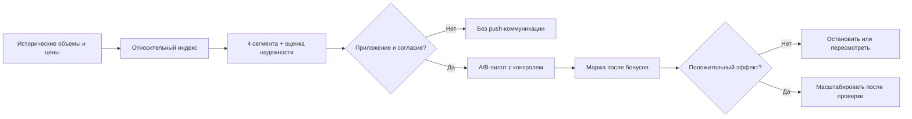

<div align="center">

# МАРЖРУТ

**Маржа + маршрут: персональная выгода без массовых скидок**

Кейс №3 · «Эластичность спроса» · Intelligence Cup 2026 · команда «ТИИм»

[](https://github.com/DizzyZ7/GAZPROM_Intelligence_Cup_2026/actions/workflows/marzhrut-ci.yml)


[**Открыть демонстрацию**](demo/index.html) · [**Методология**](docs/МЕТОДОЛОГИЯ.md) · [**Экономика**](docs/ЭКОНОМИКА.md) · [**Команда «ТИИм»**](../../README.md)

</div>

## Задача и ценность

Программа лояльности «Нам по пути» объединяет миллионы автомобилистов. Однако не все активные клиенты одинаково реагируют на разницу между ценой топлива на АЗС сети и у конкурентов. Одинаковая скидка каждому дорого обходится и не дает уверенности, что она удержала именно ценочувствительного клиента.

**«Маржрут»** — аналитический прототип для трех последовательных решений: найти *кандидатов* с наблюдаемой реакцией на относительную цену → предложить адресную маркетинговую механику → измерить **инкрементальную маржу в контролируемом пилоте**.



## Что измерено на предоставленных данных

| Показатель | Результат |
|---|---:|
| Клиентов в основной таблице | **33 146** |
| АЗС в основной таблице | **642** |
| Комбинаций АЗС × топливо | **1 837** |
| Наблюдения | **9 месяцев**: 09.2023–05.2024 |
| Суммарный объем | **29 891 102,55 л** |
| Кандидатов с сильным сигналом | **6 715** |
| С умеренным сигналом | **1 342** |
| Без обнаруженного сигнала | **15 689** |
| С недостатком данных | **9 400** |
| Кандидаты с приложением и указанным согласием на push | **4 823** |

Числа получены по **фиксированным экспертным порогам**, а не по доказанной индивидуальной ценовой эластичности. Источник: предоставленная организаторами историческая книга XLSB, 6 листов. Все опубликованные результаты — агрегаты, без клиентских идентификаторов.

### Самая важная проверка

Совпадение направления индивидуального индекса между двумя временными окнами — всего **49,2%** среди пригодных для этой проверки наблюдений. Поэтому нельзя утверждать, что найденные 8 057 человек точно «уйдут из-за цены» или что скидки уже экономически оправданы. Это **приоритизированная гипотеза**, которую нужно валидировать экспериментально. Сводная месячная корреляция объемов и цен **−0,942** также не устанавливает причинность.

## Все три задачи кейса

| Задача организатора | Результат |
|---|---|
| 1. Выявление ценозависимых клиентов | Воспроизводимый индекс реакции, четыре сегмента, реальное количество клиентов, тест устойчивости и ограничения |
| 2. Маркетинговые механики | Матрица механик, автоматическое начисление через приложение при актуальном согласии, клиентский путь «было/стало» |
| 3. Экономический эффект | Расчет маржи на литр из предоставленных справочников, сценарии, порог безубыточности, дизайн контрольного эксперимента |

### Как формируется наблюдаемый индекс

Для клиента считаем `log(1 + литры)` относительно **медианы других клиентов** той же АЗС, вида топлива и месяца (leave-one-out). Затем оцениваем регуляризованный наклон этой относительной величины к `цена сети − цена конкурентов`. Для допуска к сегментации нужны минимум 8 клиентов в группе, 6 активных месяцев, 200 л за весь период и размах ценовой разницы не меньше 1 руб./л. Это индикатор, **не** причинная эластичность и **не** вероятность оттока.

[Формулы, пороги и статистические оговорки](docs/МЕТОДОЛОГИЯ.md)

### Как удерживаем без лишних скидок

- **Высокий сигнал:** ограниченный персональный бонус в тестовой группе, только при действующем согласии и положительной предварительной экономике.
- **Умеренный сигнал:** меньший стимул либо мягкое ценностное сообщение; определить вариант по результатам теста.
- **Не выявлен:** не расходовать скидочный бюджет на основании цены, использовать обычную программу лояльности.
- **Недостаточно данных:** сначала накопить наблюдения, не отправлять рискованные «персональные» предложения.

Механика «было → стало»: *увидел цену → сравнил с конкурентом → уехал* превращается в *получил разрешенное персональное предложение → при заправке бонус применился автоматически → клиент сохранил выбор АЗС*. Фактическую эффективность должен подтвердить A/B-пилот, а не сам факт получения push.

[Маркетинговая программа](docs/МАРКЕТИНГ.md) · [Вопросы жюри](docs/ЗАЩИТА.md)

## Экономика и пилот

Сценарная формула в рублях на участника **тестовой** группы:

`ожидаемая добавочная маржа = uplift_литров × маржа_на_литр − P(использования) × чек_литров × бонус_руб/л − стоимость_коммуникации`

Скидка учитывается на **весь подходящий чек**, в том числе на литры, которые клиент купил бы и без предложения. В `src/economics.py` это расчет с проверкой входных границ. `src/pilot.py` содержит воспроизводимое HMAC-распределение в контрольную и тестовую группы; **сам пилот еще не запускался**. Для распространения оффера проверять актуальное согласие, ожидаемую прибыльность и достоверность uplift по эксперименту.

В формуле маржи справочник организатора дает маржу и OPEX отдельно. Прежде чем вычитать OPEX, нужно уточнить учетное определение маржи: двойной вычет недопустим.

[Финансовые допущения](docs/ЭКОНОМИКА.md)

## Как запустить и проверить

Python 3.11+; команды из `cases/retail-marketing`:

```bash
python -m pip install -r requirements.txt
python -m unittest discover -s tests -v
python src/analyze.py --input "/путь/к/Кейс_Ретейл и маркетинг_Дополнительные данные.xlsb" --output outputs
```

HTML-демо [demo/index.html](demo/index.html) открывается локально без сервера и внешних API. Оно показывает опубликованные агрегаты и редактируемые **гипотетические**, а не измеренные параметры оффера.

### Файлы

| Путь | Назначение |
|---|---|
| `src/analyze.py` | Классификация, индексы, расчет агрегатов, sanity-checks |
| `src/xlsb_reader.py` | Локальное чтение именно конкурсного формата XLSB, без выполнения макросов |
| `src/economics.py` | Безубыточность, сценарная маржа, запрет некорректного оффера |
| `src/pilot.py` | Псевдослучайная разбивка для будущего A/B, без выгрузки ID |
| `outputs/*` | Агрегированные метрики и сегменты без ID клиентов |
| `demo/index.html` | Автономный демонстрационный интерфейс |
| `docs/*` | Методология, клиентский путь, экономика, защита |
| `tests/*` | Проверки сегментов, консервации чисел, экономических ограничений и рандомизации |

## Безопасность и границы

- **Исходный XLSB не публикуется**. В Git находятся только исходники и обезличенные сводные значения.
- Обработка полностью локальная, без внешних LLM или запросов к внешним сервисам.
- Исторические поля наличия приложения и согласия на push **не являются действительным согласием сегодня**: перед коммуникацией нужна проверка в системе лояльности.
- Нет геолокации, realtime-цен, данных по полученным бонусам, доказанной причинной эластичности, A/B-результатов или корпоративной интеграции.
- Прототип не выполняет рассылок, не назначает скидок и не принимает коммерческих решений автоматически.
- Дополнительные обработки и идентификация клиентов в промышленной системе требуют согласованных прав доступа и политик обработки данных.

Воспроизводимые результаты ≠ доказанный бизнес-эффект. Это честное, проверяемое обоснование будущего пилота.